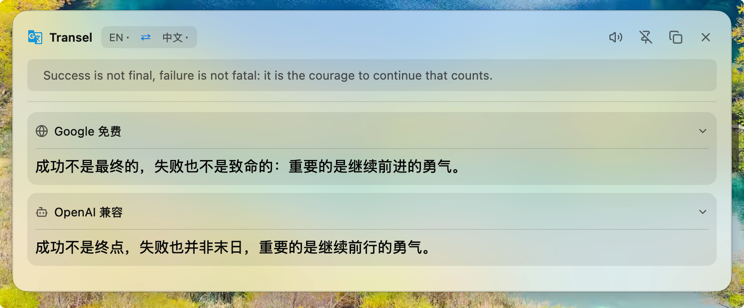

<div align="center">
  
</div>

# Transel

跨平台划词翻译工具。选中文字后按下热键，译文显示在鼠标附近的浮窗中。

支持 macOS、Windows、Linux。可同时对照多个翻译接口，并提供截图 OCR、静默替换、历史与收藏。日常以系统托盘常驻。

## 介绍

Transel 面向阅读与写作时的即时翻译：在浏览器、编辑器或其它应用中划词，用全局热键唤出结果，而不必切换到翻译网站。

- 划词翻译：读取当前选区（文本、图片或文本文件）
- 多通道对照：多家接口并行出结果
- 截图识别：框选屏幕区域后 OCR，可选翻译或只复制文字
- 静默替换：将译文写回选区或当前输入框
- 密钥保存在系统钥匙串，配置文件不保存明文

默认目标语言为简体中文，可在设置中修改。新安装默认仅启用系统翻译（macOS 为 Apple 翻译，其它平台为 Google 免费）；其它接口在设置中点「添加」后再配置。

## 功能

| | |
|---|---|
| 划词翻译 | 默认 `Alt+D`（macOS 为 Option+D），浮窗显示原文与译文 |
| 输入翻译 | 弹出输入框，回车翻译 |
| 截图 OCR | RapidOCR，以及火山 / 腾讯 / 百度 / 有道 / Google 云识别；腾讯图片翻译 |
| 原图翻译 | 在截图上标出识别区域并翻译 |
| 静默替换 | 译文写回选区或输入框全文；指针旁可停止当前任务 |
| 翻译接口 | 机器翻译（Apple 系统翻译、DeepL、Google、微软、Amazon、百度、有道、阿里、火山、彩云、小牛 Flash / Pro 等）与 LLM 通道（OpenAI / Azure / Claude / Gemini / 智谱 / DeepSeek / 通义 / 豆包 / Kimi / Ollama 等） |
| 词典 | 英语单词：音标、词性、例句 |
| 朗读 | 系统 TTS，以及火山 / 腾讯 / Google / Microsoft 云语音 |
| 历史 / 收藏 | 应用内搜索 |
| 托盘 | 设置、历史、输入翻译、截图 OCR、固定浮窗、退出 |

### 默认快捷键

Windows / Linux 上 `Cmd` 对应 **Ctrl**。可在设置中修改；将按键留空即取消注册。

| 功能 | 快捷键 |
|---|---|
| 翻译选区 | Alt+D |
| 截图翻译 | Alt+F |
| 截图 OCR（不翻译） | Shift+Alt+S |
| 静默 OCR（只写入剪贴板） | Alt+C |
| 输入翻译 | Cmd+Shift+I |
| 朗读选区 | Cmd+Shift+R |
| 历史 | Cmd+Shift+H |
| 设置 | Cmd+, |
| 固定 / 取消固定浮窗 | Cmd+Shift+P |
| 原图翻译 | Alt+Shift+O |
| 收藏夹 | Cmd+Shift+F |
| 静默划词替换 | Alt+S |
| 静默输入框替换 | Alt+A |

关闭当前窗口：`Esc` 或 `Cmd+W`。macOS 退出应用：`Cmd+Q`。

## 安装

从 [Releases](https://github.com/your-org/transel/releases) 下载对应平台的安装包。

### macOS

1. 下载 `Transel-<version>-aarch64-apple-darwin.dmg`（Apple 芯片）或 `Transel-<version>-x86_64-apple-darwin.dmg`（Intel）。
2. 打开磁盘映像，将 Transel 拖入「应用程序」。之后可用聚焦（Spotlight）或启动台搜索「Transel」。
3. 打开 **系统设置 → 隐私与安全性 → 辅助功能**，启用 Transel。若从终端启动，请授权「终端」或 iTerm，然后完全退出并重新打开。未授权时无法读取选区。

若提示「已损坏，无法打开」或无法打开未验证的开发者应用：这是 Gatekeeper 拦截未公证的下载包，不是文件真的坏了。在终端执行：

```bash
xattr -cr /Applications/Transel.app
```

然后再次打开。从浏览器下载的 DMG 也会带隔离属性，可先对磁盘映像执行 `xattr -cr ~/Downloads/Transel-*.dmg` 再打开。

### Windows

安装 `Transel-<version>-x86_64.msi`，或解压 zip 后运行 `transel.exe`。

以管理员身份运行的窗口，需以相同权限运行 Transel，否则可能无法读取选区。

### Linux

Debian / Ubuntu：

```bash
sudo dpkg -i transel_<version>_amd64.deb
```

或使用 AppImage：

```bash
chmod +x Transel-<version>-x86_64.AppImage
./Transel-<version>-x86_64.AppImage
```

建议：

- 安装托盘支持（GNOME 需 AppIndicator 扩展）
- Wayland 下全局热键通常仅对 XWayland 窗口有效；划词依赖 `wl-clipboard`，交互截图依赖 `grim` 与 `slurp`
- 需要稳定热键时，优先使用 X11 会话

### 配置翻译接口

启动后通过托盘打开「设置」，启用所需接口并填写 API Key。OpenAI 兼容通道（智谱、硅基流动、Groq、Ollama 等）已预置地址与默认模型。密钥写入系统钥匙串（macOS Keychain、Windows 凭据管理器、Linux Secret Service）。云 OCR / TTS 也可使用环境变量，例如 `TENCENT_SECRET_ID`、`VOLCANO_ACCESS_KEY`、`GOOGLE_OCR_API_KEY`、`VOLCANO_TTS_TOKEN`。

配置文件位置：

| 平台 | 路径 |
|---|---|
| macOS | `~/Library/Application Support/dev.transel/config.json` |
| Windows | `%APPDATA%\dev.transel\config.json` |
| Linux | `~/.config/dev.transel/config.json` |

命令行工具 `transel-cli`：

```text
transel-cli config show
transel-cli config set target zh-CN
transel-cli history search <关键词>
transel-cli backend list
```

临时覆盖 OpenAI 兼容接口（明文，仅建议调试使用）：

```bash
export TRANSLATE_API_BASE=https://api.deepseek.com/v1
export TRANSLATE_API_KEY=sk-xxx
export TRANSLATE_MODEL=deepseek-chat
```

### 从源码构建

需要 Rust 1.88 或更高版本。

```bash
git clone https://github.com/your-org/transel
cd transel
cargo run --release
```

**macOS**：安装 Xcode Command Line Tools（`xcode-select --install`）。

**Windows**：安装 Visual Studio Build Tools，并勾选「使用 C++ 的桌面开发」。

**Linux**（Debian / Ubuntu）：

```bash
sudo apt install build-essential pkg-config cmake clang \
  libxkbcommon-dev libxkbcommon-x11-dev libwayland-dev libvulkan-dev mesa-vulkan-drivers \
  libx11-xcb-dev libxcb1-dev libxcb-randr0-dev libxcb-xfixes0-dev libxcb-shape0-dev \
  libfontconfig-dev libfreetype-dev libssl-dev libzstd-dev \
  libgtk-3-dev libayatana-appindicator3-dev libxdo-dev libxi-dev libxtst-dev \
  espeak-ng wl-clipboard grim slurp maim gnome-screenshot
```

在本机生成安装包：

```bash
# macOS / Linux
bash packaging/package.sh --build

# Windows（PowerShell 7+）
pwsh packaging/package.ps1 -Build
```

产物位于 `dist/`。推送 `v*` 标签时，CI 会构建 macOS（arm64 / x86_64）、Windows x86_64 与 Linux x86_64 并发布到 Releases。

## 许可

本项目采用 [MIT](https://opensource.org/licenses/MIT) 许可证。
